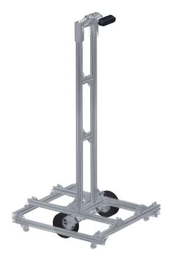
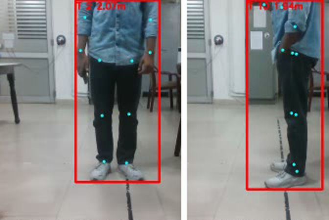
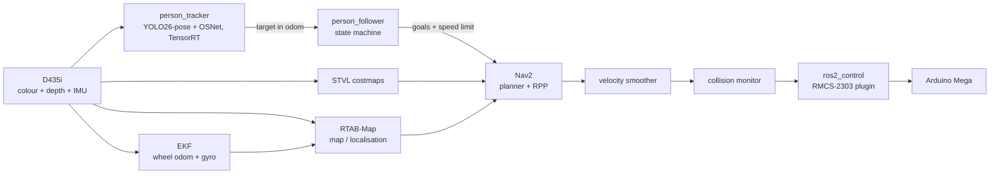
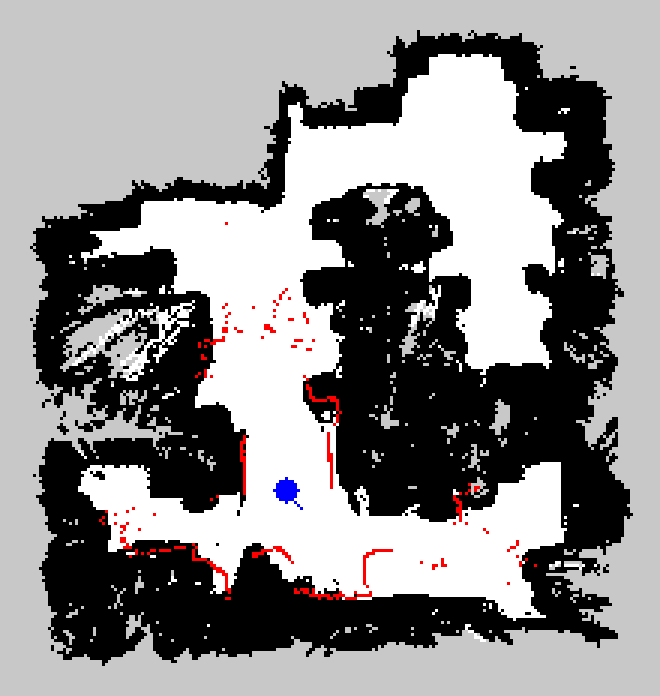

# labrobot_ws

A camera-only indoor robot on ROS 2 Humble: it maps the lab, localises itself without markers,
navigates with Nav2 and follows a chosen person, all from a single Intel RealSense D435i.

<p align="center">
  
  &nbsp;&nbsp;
  
</p>
<p align="center"><sub>Left: the robot (CAD model). Right: the follow target locked (red) and
re-identified side-on after leaving the view.</sub></p>

## Features

- **Mapping and localisation**: RTAB-Map RGB-D SLAM; automatic start-up localisation by turning
  in place and scan-matching against the saved map (no fiducials, recovers after being carried).
- **Navigation**: Nav2 with Smac 2D and Regulated Pure Pursuit; spatio-temporal voxel costmaps
  from depth; `nav2_collision_monitor` as a last safety stop; named waypoint missions.
- **Person following**: YOLO26-pose and OSNet re-ID on the GPU (TensorRT FP16), BoT-SORT-style
  tracking with odometry motion compensation and a depth gate, online appearance memory for
  re-identification, and a Nav2 behaviour tree that keeps a 1.2 m stand-off.
- **Operation**: one-command bringup and stop, Foxglove over SSH, health checks and logs.

## Hardware

| Part | Detail |
|---|---|
| Base | Differential drive, 0.42 x 0.41 m, 0.86 m tall, four swivel casters |
| Compute | Jetson Orin Nano 8 GB (JetPack 6, CUDA 12.6, TensorRT 10.3) |
| Sensor | RealSense D435i at 0.844 m, pitched 10.8° down (the only sensor) |
| Drive | Arduino Mega + 2 x RMCS-2303 (MODBUS), RMCS-5030 motors, watchdog brake |
| Power | 3S LiPo |

## Architecture



<p align="center">
  
  <br><sub>Markerless localisation: the live depth scan (red) matched to the saved map.</sub>
</p>

## Repository

| Path | Contents |
|---|---|
| `src/labrobot_description` | URDF/xacro, meshes, controller config |
| `src/labrobot_hardware` | ros2_control plugin for the Mega / RMCS-2303 link |
| `src/labrobot_bringup` | launch files, Nav2/EKF/collision-monitor config, robot scripts |
| `src/labrobot_follow` | person detection, tracking, re-ID and the follower |
| `firmware` | Arduino Mega firmware with host-side unit tests |
| `scripts`, `tools` | operator scripts and diagnostics |
| `docs` | operator guide and engineering report |

## Quick start

```bash
# build
cd ~/ros2_ws && colcon build --symlink-install

# start everything (the robot turns in place to localise)
scripts/bringup_nav.sh --localization

# drive: a goal 1 m ahead, or a waypoint mission
ros2 run labrobot_bringup nav_goal.py --forward 1.0
ros2 run labrobot_bringup waypoints.py go a1 a2 a3 --wait-start

# person following (models: tools/build_follow_models.sh)
scripts/follow.sh --dry-run        # plans only, the robot does not move
scripts/follow.sh                  # follows after "start" on /labrobot/follow_cmd

# stop / power off
scripts/stop_robot.sh
scripts/shutdown_robot.sh
```

Foxglove: `ssh -N -L 8765:localhost:8765 <user>@<robot>` and connect to `ws://localhost:8765`.

## Documentation

- [Operator guide](docs/OPERATOR_GUIDE.md): day-to-day use, Foxglove setup, troubleshooting.
- [Project report](docs/PROJECT_REPORT.md): design decisions, problem log and measured constants.

## Status

Mapping, localisation, navigation and waypoint missions are tested on hardware. Person following
works at 0.06 m/s with the operator in front; higher speeds (configured up to 0.20 m/s) are still
being tested.

## License

Apache-2.0 for this code. The person detector uses Ultralytics YOLO weights (AGPL-3.0); they are
downloaded and built locally, not included here.

Author: Abhinav Garg
